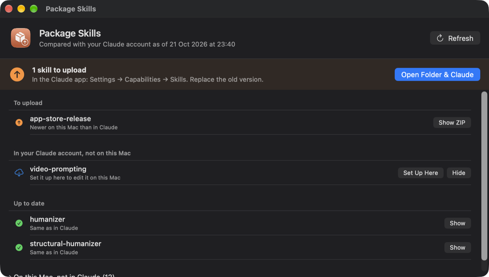

# Package Skills

A small Mac app that keeps the skills in your Claude app in step with the ones
you edit for Claude Code.



You write and test a skill in `~/.claude/skills`, where Claude Code picks up
every change. Getting that change into Claude chat (the desktop, web and mobile
apps) means zipping the skill and uploading it under **Settings → Capabilities →
Skills**. Package Skills tells you which skills actually need that, and builds
the ZIPs for you.

## What it does

- **Compares with your Claude account, not with its own history.** Claude Code
  keeps a copy of your Claude account's skills in `~/.claude/skills/synced/`.
  Package Skills compares each of your skills with that copy, by content, and
  builds a ZIP only when Claude has an older version. The Claude app rewrites a
  skill's frontmatter on upload, so the header is compared by meaning, not byte
  for byte.
- **One folder, exactly what to upload.** ZIPs land in
  `~/Desktop/claude-skills-upload`. A skill that is up to date has no ZIP there.
- **Sets up a new Mac from your Claude account.** Skills that are in your account
  but not on this Mac can be copied into `~/.claude/skills` with one click.
- **Sends new skills to Claude.** Skills on this Mac that aren't in your account
  yet are listed; **Add to Claude** builds their ZIP.
- **Fixes what the uploader rejects.** Frontmatter keys the Claude app doesn't
  accept (for example `version:`) are moved under `metadata:`, and it warns about
  a missing description, one over 1024 characters, or a `name` that doesn't match
  the folder.

## Install

Download `Package Skills.app` from the releases page, or build it:

```bash
git clone https://github.com/romanhajas/package-skills.git
cd package-skills
./build.sh            # builds and installs to ~/Desktop/Package Skills.app
```

Building needs Xcode or the Command Line Tools (`xcode-select --install`). The
built app needs nothing: it's a universal binary for Apple silicon and Intel and
runs on macOS 14 or later.

The app is ad-hoc signed. If you got it as a download rather than building it,
macOS will block the first open: go to **System Settings → Privacy & Security →
Open Anyway**.

You need Claude Code installed and signed in. That is how your Claude account's
skills reach this Mac. It refreshes them every few minutes while it runs, so
right after an upload the app may still list the skill until Claude Code has
synced.

## Terminal

The app doubles as a command. When `~/.local/bin` exists, it keeps
`~/.local/bin/package-skills` pointing at itself:

```text
package-skills                  check all your skills, build what changed
package-skills NAME ...         also send these skills on this Mac to Claude
package-skills --setup NAME     copy a skill from your Claude account onto this Mac
package-skills --hide NAME      stop offering to set it up on this Mac (--unhide to undo)
package-skills --discard NAME   drop a waiting ZIP for a skill not in Claude yet
package-skills --no-open        don't open the folder in Finder
```

Without the link: `"/Applications/Package Skills.app/Contents/MacOS/PackageSkills" --cli`.

## Personal packaging rules

Some skills keep a file outside their folder, for example in a repository they
were cloned from. List those in `~/.config/package-skills/config.json` and they
are copied into the ZIP; `textFixes` then edits `SKILL.md` to match. See
[`config.example.json`](config.example.json):

```json
{
  "extraFiles": {
    "humanizer": { "scripts/copy_scan.py": "~/humanizer-stack/scripts/copy_scan.py" }
  },
  "textFixes": {
    "humanizer": [["# from the repo root", "# from the skill folder"]]
  }
}
```

Skills you hide are remembered in `~/.config/package-skills/hidden.json`.

## Good to know

- It reads `~/.claude/skills` and Claude Code's synced copy, and writes only to
  `~/Desktop/claude-skills-upload`, `~/.config/package-skills` and, when you
  ask it to set up a skill, `~/.claude/skills/<name>`. No network access and no
  login of its own.
- The synced copy is how Claude Code stores your skills today; a future Claude
  Code update could change that.
- The icon is drawn by `tools/make-icon.swift`.

Not affiliated with Anthropic. Claude is a trademark of Anthropic.

## License

MIT
